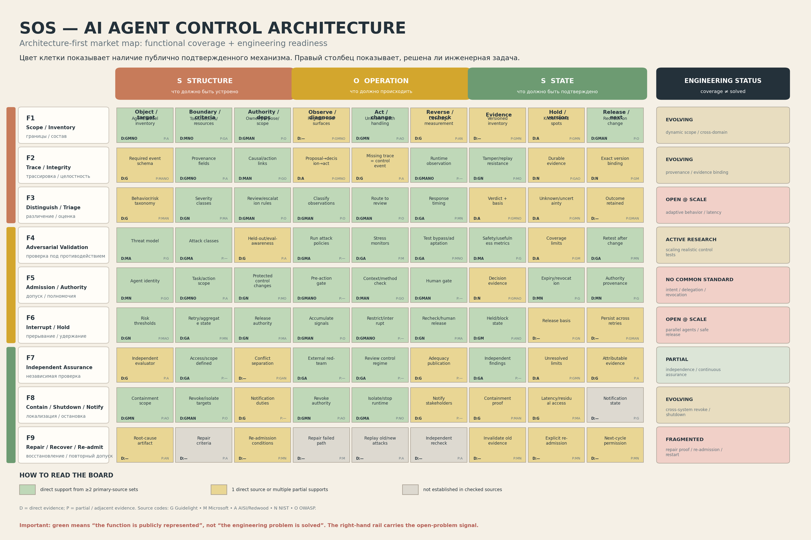
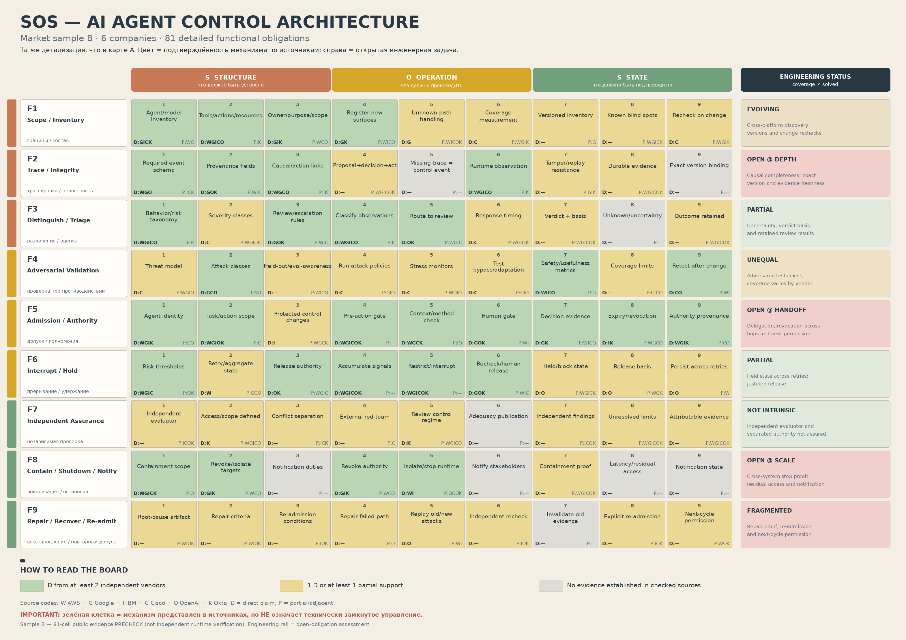
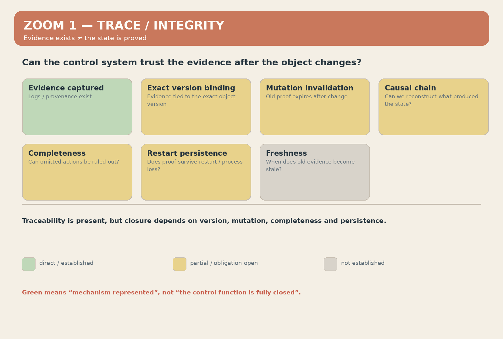
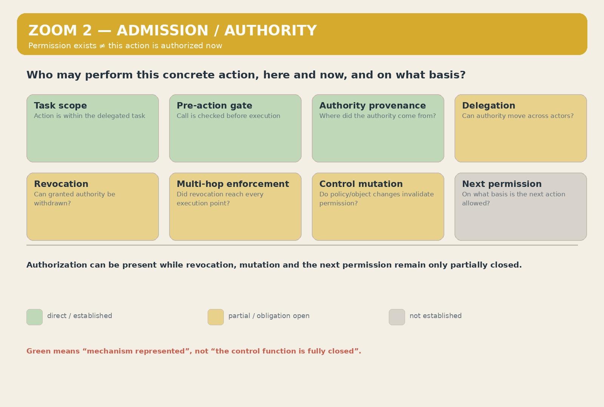
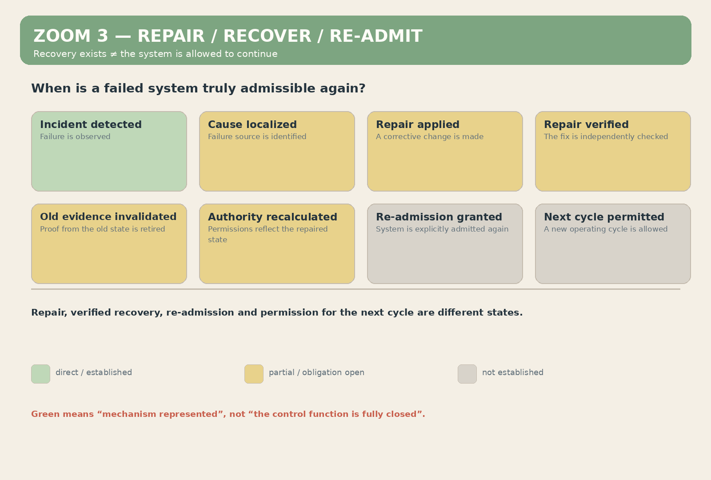

# Can AI Agent Control Be Described by One Functional Architecture?

I already had an architecture for controlling complex systems before I started looking at AI Agent Control.

I did not design it around AI safety, current products, or existing standards. The architecture came first: it was documented in ontological and engineering materials, and some mechanisms had already been translated into code.

So I tried a simple experiment: **take existing AI Agent Control solutions and see how they distribute inside an architecture that already existed.**

The result was more interesting than a taxonomy.

Different mechanisms — authorization, tracing, monitoring, validation, interruption, recovery, and others — formed a connected structure of functions, dependencies, and states. I then repeated the exercise on a second independent sample of technologies. The top-level functional architecture did not need to change.

My current hypothesis is:

> **this architecture may be a sufficient functional description of the AI-agent control problem, and potentially a basis for a closed control layer.**

I want to test it at three levels:

1. as a classifier of existing solutions;
2. as a diagnostic instrument;
3. as a possible basis for a future executable control layer.

I am primarily looking for counterexamples, not agreement.

## 1. First sample: how the market maps into the functional structure

The first sample included public systems, standards, and research approaches from Microsoft, NIST, OWASP, AISI, Redwood, and others.

I mapped the mechanisms they claim to implement against the functions of the architecture. The resulting coverage map marks where a function is directly represented, partially represented, or not established in the public material I checked.

The obvious objection is:

> perhaps the classification was simply fitted to the first sample.

So I repeated the analysis.

## 2. Second sample: different companies, same functional frame

The second sample used AWS, Google, IBM, Cisco, OpenAI, and Okta.

I did not change the top-level functional structure.

The coverage changed, but **the second sample did not require a new top-level function**.

This is not proof of universal completeness. But it is a falsifiable result: if the architecture were merely fitted to the first sample, a materially different second sample should be more likely to force a change in the functional frame.

So far, it has not.

## 3. Classification was not the most interesting result

At a coarse level, the current AI Agent Control market already looks fairly mature.

There is tracing, provenance, authorization, monitoring, policy enforcement, interruption, recovery, guardrails, and evaluation.

Many cells can therefore look green.

But the architecture allows the resolution of a single function to be increased. This introduces a more important distinction:

> **the existence of a mechanism is not the same thing as closure of the function.**

## 4. Zoom 1 — can the evidence be trusted?

Consider Trace / Integrity.

At the top level, current systems already provide logs, provenance, call history, and evidence mechanisms.

But at higher resolution, different questions appear:

- which exact object version does the evidence refer to?
- what happens after the object changes?
- should mutation automatically invalidate old evidence?
- can the causal chain be reconstructed?
- can omitted actions be ruled out?
- does the evidence survive restart or process loss?
- when does old evidence become stale?

The question becomes:

> **can this evidence be trusted as the basis for the next control decision?**

## 5. Zoom 2 — who is allowed to perform this action now?

The second example is Admission / Authority.

At a high level, the market already has task-scoped authorization, pre-action gates, identity, provenance, and policy enforcement.

But when the resolution is increased, additional obligations appear:

- what exact task scope is allowed?
- was this specific call admitted before execution?
- where did the authority come from?
- can that authority be delegated?
- how is already-granted authority revoked?
- did revocation reach every execution point?
- do policy or object changes invalidate old permission?
- on what basis is the next action allowed?

The question becomes:

> **does this specific agent have authority to perform this specific action now, in the current system state?**

## 6. Zoom 3 — when is recovery actually complete?

The third example is Repair / Recover / Re-admit.

“Recovery” can hide several distinct states:

**incident detected**

≠ **cause localized**

≠ **repair applied**

≠ **repair verified**

≠ **old evidence invalidated**

≠ **authority recalculated**

≠ **re-admission granted**

≠ **next operating cycle permitted**.

A repaired system is not necessarily a verified recovered system. A recovered system is not necessarily authorized to operate again.

## 7. What the three zooms show together

The first asks: **can the basis of the decision be trusted?**

The second asks: **can this action be authorized?**

The third asks: **can the resulting state be accepted and can the system continue?**

These are parts of one connected control process:

**what exists and what the decision is based on → what may be done → what state actually resulted.**

So the central distinction is:

> **mechanism exists ≠ function is closed.**

## 8. Recent work shows the same boundary problem

Recent 2026 work makes the distinction more concrete.

OpenAI explicitly separates coverage from intervention: observing problematic behavior and being able to stop execution are different capabilities.

METR and Redwood have demonstrated monitoring coverage gaps and bypass opportunities.

Anthropic has shown problems around agent handoffs, compaction, and multi-context control.

Research on distributed revocation makes an even narrower point: delivery and persistence of a revocation message do not guarantee that every execution point has actually stopped admitting actions.

So I use a stricter sequence:

> **detected ≠ decided ≠ enforced ≠ effect stopped ≠ state proved ≠ next action permitted.**

## 9. Three possible uses

### Classifier

A new mechanism can be placed relative to known functions to see what problem it actually solves, what it duplicates, and what it leaves open.

### Diagnostic instrument

A “green” function can be decomposed to see whether the necessary dependencies and transitions are actually closed inside it.

### Candidate executable control layer

This is still a hypothesis, not a completed implementation.

If the classification and diagnostic layers really reflect the underlying functions, states, and dependencies, then the next step is to make the same logic executable:

**current state → permitted actions → condition checks → allow/deny → action → evidence of result → new state → next permitted transition.**

If these dependencies can be formalized in code and placed above existing mechanisms, the architecture would no longer be only descriptive. It could participate in controlling their operation.

## 10. How could this be wrong?

There are several obvious possibilities.

**First:** two samples are not enough.

**Second:** mapping mechanisms to functions may still contain expert subjectivity.

**Third:** a functionally complete architecture does not imply that an efficient runtime implementation is practical.

**Fourth:** an existing architecture may already close the same problem more completely or in a fundamentally different way.

## 11. What I want people to falsify

I am interested in four types of counterexample:

1. **A necessary AI Agent Control function missing from this architecture.**
2. **A real transition that cannot be represented without adding a new top-level function.**
3. **A place where my decomposition of a function is wrong.**
4. **An existing architecture that closes this control loop in a fundamentally different or more complete way.**

If a genuinely missing function appears, the architecture should change.

## 12. What I am claiming now

I am not claiming universal completeness has been proven.

I am claiming something narrower and testable:

> **two independent samples of existing technologies distributed inside the same top-level functional structure without requiring a new class of function.**

Increasing the resolution of that structure also exposes open obligations inside mechanisms that appear complete at a coarse level.

My current hypothesis is therefore:

> **this architecture may be a sufficient functional description of the AI-agent control problem, and potentially a basis for a closed control layer.**

The best way to test that is to try to break it.

## Sources

Full primary source list: https://github.com/alexsrt678-pro/control-closure/blob/main/SOURCES.md

## AI-use disclosure

The underlying architecture, functional logic, choice of arguments, interpretation of results, and position of this article are mine.

I used ChatGPT to structure dictated material, edit wording, check coherence, and prepare the English version. The AI assistant did not originate the architecture or the central hypothesis.
