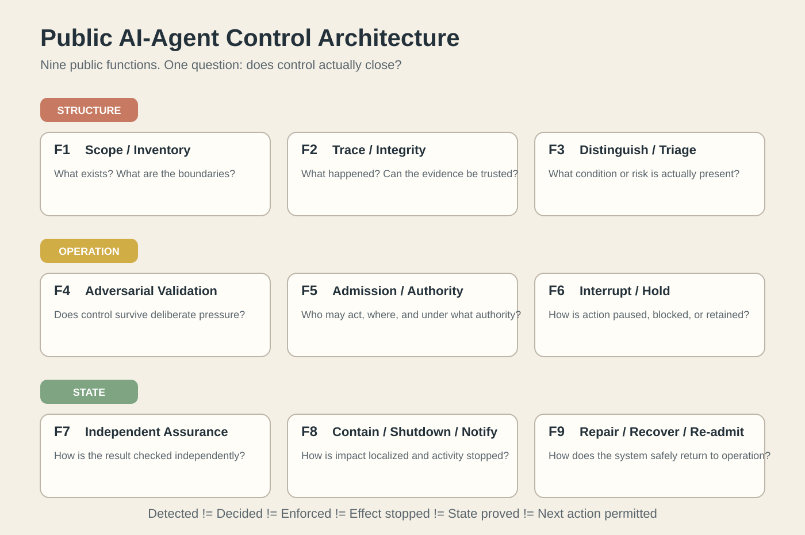

# Я собрал технологии контроля AI-агентов в одну архитектуру. Главный вопрос оказался не там, где я ожидал

У меня уже была собственная системная архитектура TRINITY задолго до этого исследования. Я не выводил её из AI safety papers, стандартов NIST или продуктов Microsoft, OpenAI и других компаний.

Здесь я сделал обратное: **взял уже существующую архитектуру и применил её к задаче контроля автономных AI-агентов.** Затем наложил на получившуюся функциональную карту реальные технологии, исследования и продукты рынка.

Мой вывод прямой:

> **для функционального управления AI-агентами этого контура достаточно.**

Это заявление можно оспаривать. Именно поэтому я публикую карту, источники и процедуру контрпримера.

## Девять функций одного управляющего контура

На публичном уровне архитектура раскладывает задачу управления на девять функций:

1. границы и инвентаризация;
2. трассировка и целостность доказательств;
3. различение состояния и первичная оценка;
4. проверка контроля под противодействием;
5. допуск и полномочия;
6. удержание и прерывание;
7. независимая проверка;
8. локализация, остановка и уведомление;
9. восстановление и повторный допуск.

Это не девять последовательных этапов. Это функции, которые могут работать одновременно и на разных глубинах.

## Первое наблюдение: рынок уже закрывает большую часть функций

Если посмотреть на Microsoft, NIST, OWASP, AISI, исследования Redwood, Guidelight и другие подходы, рынок не выглядит пустым. Почти у каждой функции есть реальные механизмы.

Затем я специально поменял выборку и повторил классификацию на AWS, Google, IBM, Cisco, OpenAI и Okta.

Покрытие изменилось. Верхняя функциональная структура - нет.

**Новой верхнеуровневой функции для второй выборки не понадобилось.**

Это не означает, что каждый продукт решает задачу полностью. Это означает другое: разные технологии снова помещаются в тот же функциональный каркас.

## Но зелёная клетка ещё ничего не гарантирует

Именно здесь началось самое интересное.

Новые публикации октября 2026 года показывают, что сама формулировка "у нас есть контроль" слишком грубая.

OpenAI прямо разделяет coverage и intervention: наблюдение может обнаружить нарушение, но это ещё не значит, что выполнение будет автоматически остановлено во всех интерфейсах и режимах.

METR и Redwood показали, что мониторинг может иметь разрывы между различными участками траектории агента.

Anthropic показала, что локальная защита может разрушаться на handoff между агентами, при compaction контекста и при обработке данных, подготовленных самим агентом.

А работа о distributed revocation показывает ещё более жёсткое различие: получение уведомления об отзыве полномочия ещё не гарантирует, что все исполнители перестали пропускать действия.

Отсюда следует формула, которую я считаю центральной:

> **Обнаружили != приняли решение != применили решение != прекратили эффект != подтвердили состояние != разрешили следующий ход.**

## Значит, проблема уже не в наличии механизмов

Рынок быстро движется к интегрированным системам. SentinelOne уже продаёт Agentic Detection and Response как связанный слой обнаружения, полномочий, наблюдения и изоляции. AWS, Google, IBM, Cisco, OpenAI и Okta также объединяют несколько функций управления в собственных стеках.

Поэтому слабый тезис звучал бы так:

> "рынок состоит из разрозненных инструментов, а я впервые их объединил".

Я его не утверждаю.

Мой тезис сильнее:

> **интеграция механизмов ещё не доказывает замыкание управления.**

Система может обнаружить проблему, принять решение, отправить команду и даже получить положительную квитанцию - а физический эффект всё ещё продолжится в другом исполнителе, контексте или ветке.

## Что тогда означает Control Closure

Я называю замкнутым управлением ситуацию, когда можно установить не только наличие команды управления, но и весь необходимый переход:

- что именно контролировалось;
- какое состояние было обнаружено;
- кто имел полномочие принять решение;
- было ли решение фактически применено;
- прекратился ли нежелательный эффект;
- каким доказательством это подтверждено;
- к какой версии системы относится доказательство;
- что стало допустимо после этого;
- требуется ли повторный допуск перед продолжением.

На этом уровне карта перестаёт быть просто каталогом продуктов.

Она становится способом диагностировать, **где именно контроль обрывается**.

## Три применения одной архитектуры

### 1. Классификатор

Новый механизм можно разместить относительно уже известных функций и понять, какую задачу он действительно решает.

### 2. Диагностическая архитектура

Можно увеличить разрешение "зелёной" функции и проверить, действительно ли внутри неё закрыты необходимые обязательства и связи.

### 3. Основа управляющего контура

Те же функции можно формализовать как входы, условия, решения, доказательства состояния и разрешения следующего перехода.

Именно этот третий уровень мне сейчас наиболее интересен как инженерная задача.

## Я утверждаю достаточность - и предлагаю её сломать

Я не публикую эту архитектуру как просьбу решить, нравится ли она рынку.

Я утверждаю, что её верхнего функционального контура достаточно для управления AI-агентами.

Если это неверно, нужен конкретный контрпример:

- обязательная функция, которой на карте нет;
- реальный переход, который карта не способна выразить;
- система управления, которая требует принципиально другой связи между функциями.

Новое название существующего механизма контрпримером не является.

Если появится реальная отсутствующая функция - архитектура должна измениться. Я опубликую такой результат.

## Что я не публикую

Публична архитектура функций, связи, рыночные сопоставления и результаты проверок.

Не публикуется внутренняя вычислительная механика TRINITY: как система определяет внутреннее место, глубину, переподбор и разрешение следующего перехода.

Мне интересна проверяемость результата, а не раскрытие двигателя.

## Что дальше

Если у вас есть публичный контрпример - принесите его в обсуждение вместе с первичным техническим источником.

Если у вас есть реальный закрытый agent stack и вы хотите понять, где в нём обрывается управление, это уже отдельный архитектурный разбор.

А если задача состоит в том, чтобы превратить такую архитектуру в исполняемый слой управления, - это техническое партнёрство, которое я сейчас ищу.

Мне интереснее не подтверждение этой модели.

**Мне интереснее место, где она сломается.**
