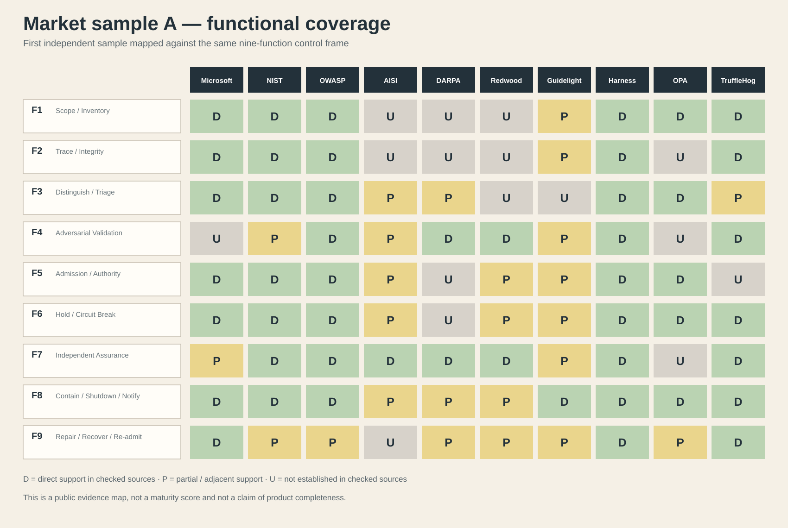
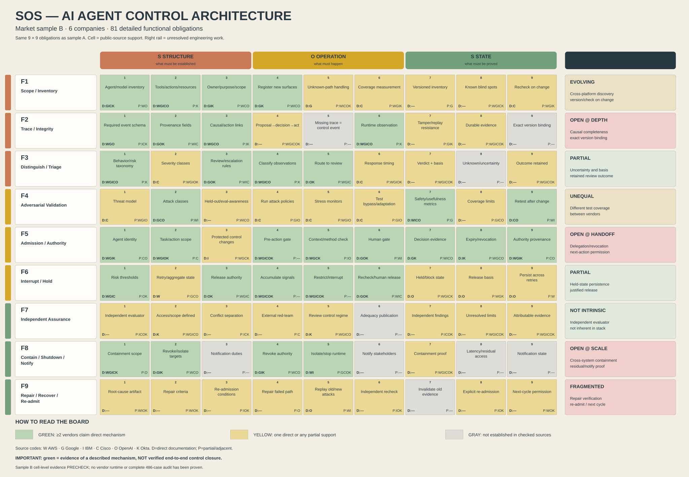
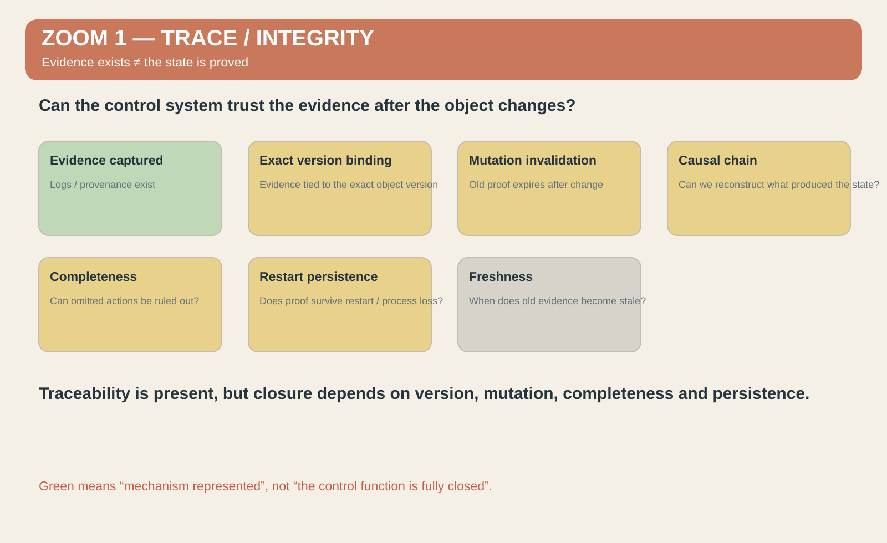
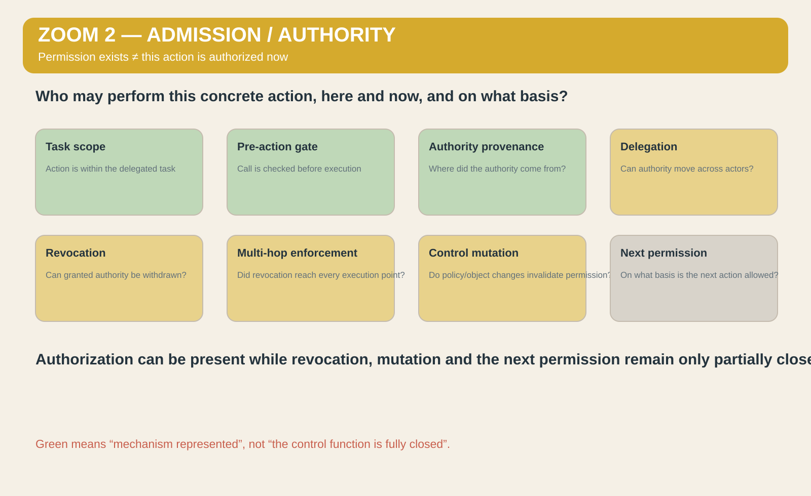
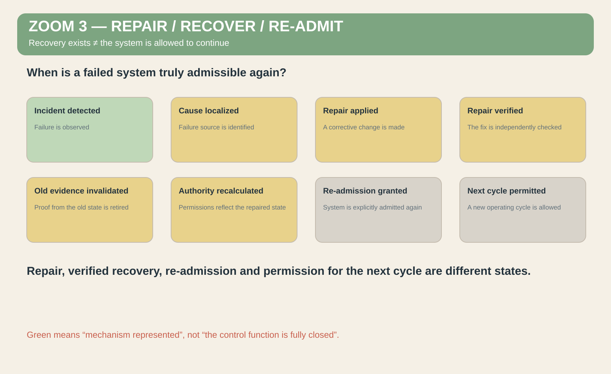

# Можно ли описать контроль AI-агентов одной функциональной архитектурой?

У меня уже была архитектура управления сложными системами, когда я начал смотреть на задачу AI Agent Control.

Я не создавал её под AI safety, существующие продукты или стандарты. Она появилась раньше и описана в системе онтологических и инженерных документов; часть механизмов уже перенесена в код.

Поэтому я решил провести простой эксперимент: **взять существующие решения рынка AI Agent Control и посмотреть, как они распределятся внутри уже существующей функциональной архитектуры.**

Результат оказался интереснее простой классификации.

Разные механизмы — авторизация, трассировка, мониторинг, проверка, остановка, восстановление и другие — сложились в связанную структуру: с функциями, зависимостями и состояниями. После этого я повторил эксперимент на второй независимой выборке технологий. Верхнеуровневую архитектуру менять не пришлось.

Моя текущая гипотеза такова:

> **эта архитектура может быть достаточным функциональным описанием задачи управления AI-агентами и потенциальной основой для замкнутого управляющего контура.**

Я предлагаю проверить её на трёх уровнях:

1. как классификатор существующих решений;
2. как диагностический инструмент;
3. как возможную основу будущего управляющего контура.

И в первую очередь меня интересуют не подтверждения, а контрпримеры.

## 1. Первая выборка: как рынок лег в функциональную карту

Первая выборка включала публичные решения, стандарты и исследовательские подходы Microsoft, NIST, OWASP, AISI, Redwood и других участников рынка.

Я сопоставил заявленные ими механизмы с функциями архитектуры и получил карту покрытия. Цветом отмечено, где функция представлена напрямую, где только частично, а где в изученных публичных материалах реализация не установлена.

На карте сразу стали видны различия. Некоторые области уже довольно плотно закрываются существующими технологиями. В других много частичных решений. Некоторые функции регулярно выглядят слабее остальных.

Но у такого результата есть очевидное возражение:

> возможно, сама классификация просто хорошо подогнана под первоначальную выборку.

Поэтому я повторил анализ.

## 2. Вторая выборка: другие компании, та же функциональная структура

Во вторую выборку вошли AWS, Google, IBM, Cisco, OpenAI и Okta.

Верхнеуровневую функциональную структуру я не менял.

Покрытие изменилось. Где-то стало больше прямых реализаций, где-то — больше частичных. Некоторые пробелы исчезли, другие сохранились.

Но **новой верхнеуровневой функции добавлять не пришлось**.

То есть разные компании, продукты, терминология и технические механизмы распределились внутри той же функциональной структуры.

Это ещё не доказательство универсальной полноты. Но это уже проверяемый результат: если архитектура была бы просто подогнана под первую выборку, второй независимый набор с большей вероятностью должен был бы потребовать изменения самой функциональной сетки.

Пока этого не произошло.

## 3. Но классификация оказалась не самым интересным результатом

На верхнем уровне современный рынок AI Agent Control уже выглядит довольно зрелым.

Есть tracing, provenance, authorization, monitoring, policy engines, interruption, recovery, guardrails и проверки.

То есть при грубом рассмотрении многие клетки карты можно сделать зелёными.

Но архитектура позволяет увеличить разрешение отдельной функции. И тут появляется другое различие:

> **наличие механизма ещё не означает замыкание функции.**

Я покажу это на трёх примерах — по одному из трёх разных слоёв: основание, действие и состояние.

## 4. Zoom 1 — можно ли доверять доказательству?

Возьмём функцию Trace / Integrity: трассировку и целостность.

На верхнем уровне рынок уже предлагает логи, provenance, историю вызовов и механизмы подтверждения происхождения информации.

Можно поставить зелёную отметку: механизм существует.

Но если увеличить разрешение, появляются другие вопросы:

- к какой точной версии объекта относится доказательство;
- что происходит с ним после изменения объекта;
- должна ли мутация автоматически делать старое доказательство недействительным;
- можно ли восстановить причинную цепочку;
- можно ли доказать отсутствие пропущенного действия;
- переживает ли доказательство перезапуск;
- когда старое evidence становится недействительным.

Вопрос уже не только в том, ведём ли мы лог.

Вопрос в другом:

> **можем ли мы доверять этому evidence как основанию для следующего управляющего решения?**

## 5. Zoom 2 — кто имеет право выполнить действие именно сейчас?

Второй пример — Admission / Authority: допуск и полномочия.

На верхнем уровне здесь уже существуют task-scoped authorization, pre-action gates, identity, provenance и policy enforcement.

Но при увеличении разрешения появляются следующие обязательства:

- какой именно task scope разрешён;
- прошёл ли конкретный вызов предварительный допуск;
- откуда получено полномочие;
- можно ли его делегировать;
- как работает отзыв уже выданного полномочия;
- дошёл ли отзыв по всей цепочке;
- что происходит после изменения политики или объекта;
- нужно ли пересчитать старое разрешение;
- на каком основании разрешается следующее действие.

Вопрос уже не «есть ли у агента permission?», а:

> **имеет ли конкретный агент право выполнить конкретное действие именно сейчас, в текущем состоянии системы?**

## 6. Zoom 3 — когда восстановление действительно закончено?

Третий пример — Repair / Recover / Re-admit.

На уровне продукта можно сказать: механизм восстановления существует.

Но само слово recovery может скрывать несколько разных состояний:

**инцидент обнаружен**

≠ **причина локализована**

≠ **исправление применено**

≠ **исравление проверено**

≠ **старые доказательства признаны недействительными**

≠ **полномочия пересчитаны**

≠ **система повторно допущена**

≠ **разрешён следующий цикл работы**.

Исправленная система ещё не обязательно является доказанно восстановленной системой. А восстановленная система ещё не обязательно имеет право снова действовать.

Здесь архитектура показывает уже не отсутствие recovery как продукта, а возможную **неполноту замыкания состояния**.

## 7. Что показывают эти три увеличения

Первый пример задаёт вопрос: **можно ли доверять основанию решения?**

Второй: **можно ли разрешить конкретное действие?**

Третий: **можно ли считать полученное состояние подтверждённым и двигаться дальше?**

Это не три случайных уязвимости. Это три части одного связного управляющего процесса:

**что существует и на чём основано решение → что разрешено сделать → какое состояние получилось.**

Отсюда центральная формула:

> **механизм существует ≠ функция замкнута.**

Именно здесь архитектура перестаёт быть только классификатором и начинает работать как диагностический инструмент.

## 8. Современные исследования показывают ту же проблему границ

Новые публикации 2026 года усиливают этот вопрос.

OpenAI отдельно различает coverage и intervention: наблюдение и возможность реально остановить выполнение — разные вещи.

METR и Redwood показывали разрывы покрытия и возможности обхода мониторинга.

Anthropic показывала проблемы на handoff между агентами, при compaction и в multi-context сценариях.

Исследование distributed revocation показывает ещё более жёсткую границу: доставка и сохранение уведомления об отзыве полномочия не гарантируют, что все точки исполнения действительно перестали пропускать действия.

Поэтому я использую более строгую последовательность:

> **обнаружили ≠ приняли решение ≠ применили решение ≠ прекратили эффект ≠ подтвердили состояние ≠ разрешили следующий ход.**

## 9. Три уровня применения

### Классификатор

Новый механизм можно разместить относительно уже известных функций и понять, какую задачу он действительно решает, что дублирует и что оставляет открытым.

### Диагностический инструмент

Можно увеличить разрешение «зелёной» функции и проверить, действительно ли внутри неё закрыты необходимые зависимости и переходы.

### Кандидат на управляющий контур

Это пока гипотеза, а не готовая реализация.

Если классификация и диагностика действительно отражают реальные функции, состояния и зависимости, следующий шаг — попробовать сделать эту же логику исполняемой:

**текущее состояние → допустимые действия → проверка условий → разрешение или запрет → действие → доказательство результата → новое состояние → следующий допустимый переход.**

Если такие связи можно формализовать в коде и поставить над существующими механизмами, архитектура перестанет быть только способом анализа и сможет участвовать в управлении их работой.

## 10. Где здесь может быть ошибка?

Есть несколько очевидных вариантов.

**Первый:** две выборки недостаточны. Следующий класс систем может потребовать функции, которой сейчас нет.

**Второй:** сопоставление отдельных механизмов с функциями может содержать экспертную субъективность. Значит, правила классификации нужно делать воспроизводимыми.

**Третий:** функционально полная архитектура ещё не означает, что её можно эффективно реализовать в runtime.

**Четвёртый:** возможно, уже существует архитектура, которая решает эту задачу лучше или замыкает её иначе.

## 11. Что именно я предлагаю опровергнуть

Мне интересны четыре типа контрпримеров.

1. **Необходимая функция AI Agent Control, которой нет в этой архитектуре.**
2. **Реальный переход, который невозможно разместить внутри неё без добавления новой функции.**
3. **Место, где моя декомпозиция функции неверна.**
4. **Существующая архитектура, которая замыкает этот контур иначе или полнее.**

Новое название уже известного механизма контрпримером не является.

Если реальная отсутствующая функция найдётся — архитектура должна измениться.

## 12. Что я утверждаю сейчас

Я не утверждаю, что универсальность архитектуры уже доказана.

Я утверждаю более конкретную вещь:

> **две независимые выборки существующих технологий распределились внутри одной и той же верхнеуровневой функциональной структуры без необходимости добавлять новый класс функций.**

Кроме того, повышение разрешения этой структуры позволяет находить незамкнутые обязательства внутри механизмов, которые на верхнем уровне выглядят реализованными.

Поэтому моя текущая гипотеза следующая:

> **эта архитектура может быть достаточным функциональным описанием задачи управления AI-агентами и потенциальной основой для замкнутого управляющего контура.**

И лучший способ это проверить — попытаться её сломать.

## Источники

Полный список первичных источников: [SOURCES.md](SOURCES.md).

## Disclosure об использовании AI

Исходная архитектура, функциональная логика, выбор аргументов, интерпретация результатов и позиция этой статьи принадлежат автору.

ChatGPT использовался для структурирования надиктованного материала, редактирования формулировок, проверки связности текста и подготовки английской версии. AI не является источником архитектуры или основной гипотезы статьи.
