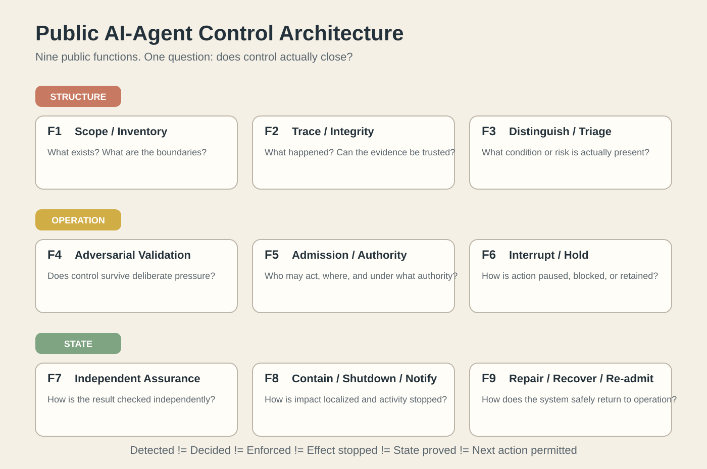

# Control Closure

**A public application of TRINITY to AI-agent control.**

TRINITY did not originate from AI safety frameworks, vendor products, or this market study. It is a broader system architecture developed independently. This repository applies that architecture to one concrete problem: **how to tell whether control over an AI agent is actually closed, rather than merely present on paper.**

## Claim

I claim that the public nine-function control architecture shown here is **sufficient as a functional control frame for AI-agent systems**.

That does not mean every market product implements every function, or that every control mechanism is mature. It means that, so far, materially different public control mechanisms can be placed inside the same functional architecture without adding another top-level control function.

The stronger question is not whether a mechanism exists. It is whether control actually closes:

**Detected != Decided != Enforced != Effect stopped != State proved != Next action permitted.**

## Public control architecture

The nine public functions are:

1. **Scope / Inventory** - what objects and boundaries exist.
2. **Trace / Integrity** - what happened and whether the evidence can be trusted.
3. **Distinguish / Triage** - what condition or risk is actually present.
4. **Adversarial Validation** - whether the control still works under deliberate pressure.
5. **Admission / Authority** - who or what may act, where, and under what authority.
6. **Interrupt / Hold** - how action is paused, blocked, or retained.
7. **Independent Assurance** - how the result is checked without relying only on the same control path.
8. **Contain / Shutdown / Notify** - how impact is localized and activity is stopped or escalated.
9. **Repair / Recover / Re-admit** - how a system returns to an admissible state and receives permission to continue.

These are **functions, not pipeline steps**. They can operate together and can be decomposed further when a coarse function appears "green" but closure is still uncertain.

## Why this repository exists

Market vendors are increasingly combining discovery, identity, policy, monitoring, isolation, and response into integrated agent-security systems. That is progress. It also makes a second question more important:

> Does an integrated control stack prove that the intended control was actually applied across the whole relevant system state and transition?

Recent public work from OpenAI, METR/Redwood, Anthropic, SentinelOne, and research on distributed revocation makes that distinction concrete. See [the evidence note](evidence/2026-11-02-control-closure.md).

## Challenge the architecture

If this architecture is insufficient, the cleanest way to show it is not by proposing another label. Bring one of these:

- a necessary control function that cannot be placed in the map without changing the top-level structure;
- a real system transition that the architecture cannot represent;
- a control stack whose closure requires a fundamentally different relationship between functions.

See [CHALLENGE.md](CHALLENGE.md).

## Test a real system

For public systems, open a Discussion with a primary technical source.

For a private agent stack, architecture review, implementation blueprint, pilot, or technical partnership: contact the author directly. Private systems are not treated as free public comment threads.

## Public boundary

This repository publishes:

- the public functional architecture;
- market mappings and evidence;
- public case analyses;
- observable input/output and closure requirements where useful.

It does **not** publish the internal TRINITY computation that derives placement, depth, re-selection, or transition authority.

## Start here

- [Flagship article - English draft](ARTICLE_EN.md)
- [Flagship article - Russian draft](ARTICLE_RU.md)
- [Evidence update - 2 Nov 2026](evidence/2026-11-02-control-closure.md)
- [Challenge protocol](CHALLENGE.md)
- [Public source map](SOURCES.md)
